> **Project focus.** As Group 2, we analyzed a public college-program dataset, audited and reproduced the exploratory analysis, trained four different regression families, selected the strongest by institution-grouped validation, tuned it without using the final test set, explained its behavior, and developed a realistic business case for responsible adoption. Our results describe *program-level reported outcomes*, not future salaries guaranteed to individuals.

# Executive summary {-}

We studied whether public institution, degree-program and occupational indicators can help explain and predict **median earnings four years after completing a bachelor's degree**. Our source was the *College Majors 2026: Earnings, Debt, Jobs, AI* dataset, compiled from College Scorecard, NCES field-to-occupation crosswalk data, Bureau of Labor Statistics occupational projections and O*NET technology indicators. It contains **227,980 rows and 72 columns**. We preserved the team's original EDA notebook byte-for-byte, independently checked its cleaning decisions and reused its existing school-separated split for every model.

Following duplicate, foreign-institution and shared-campus checks, we retained **212,707 unique U.S. program records**. Only **51,818 (24.36%)** reported our four-year earnings variable. We focused on the **25,283 reported bachelor's programs**, with **19,512 programs from 1,420 institutions** for development and **5,771 programs from 379 entirely different institutions** reserved for final evaluation. Our selection and tuning used five nonoverlapping institution folds within the development data.

**Principal findings.** Histogram Gradient Boosting achieved the lowest mean five-fold validation MAE, **USD 6,880.79**, marginally ahead of Random Forest at USD 6,918.22. Tuning 12 candidate settings improved boosting validation MAE to **USD 6,855.28**. After parameters were frozen, the model achieved **USD 6,956.68** MAE, **USD 10,111.64** RMSE and **0.7793** R-squared on the untouched school-level holdout. A mean-only predictor had USD 16,137.72 MAE on that same test: the model lowered average absolute error by **56.89%** against a simple benchmark. By contrast, tuning lowered holdout MAE only **USD 36.34** relative to untuned boosting, an improvement whose institution-resampled uncertainty interval includes zero.

Our interpretability checks found that **field of study, projected occupational growth, AI-software occupation share, and occupation wage** were strong predictive inputs. These are not proven causal levers. Errors were larger for unusually high-earning programs, and missing outcome reporting may exclude small or atypical programs. We therefore recommend a **human-supervised college-program comparison prototype** with transparent limitations rather than an automated ranking of students or colleges.

**Deliverables.** We provide the original EDA notebook, two separate executable modeling phases, a post-fit interpretability analysis, machine-readable metrics and CSV evidence, a business case, an editable Word document, the Markdown source of this report, and this PDF. The project can be reproduced using the instructions at the end.

# Project objective and business motivation

## Problem we aimed to solve

College students and advisors want to understand how program and institution characteristics are associated with economic outcomes, but direct comparisons can be misleading. A program's median reported salary reflects many intertwined factors: study field, prior student selection, local labor markets, type of institution, occupational pathways and statistical suppression. The same college may offer majors with very different earnings, while the same major varies across colleges.

We framed our primary machine-learning problem as **supervised regression**: predict **`median_earnings_4yr_usd`** from attributes available at the institution, program and occupational-context levels. Our intended output is a **program-level benchmark**, not a counterfactual return on tuition or an individual graduate salary forecast.

Our research goals were to: (1) understand and audit the dataset; (2) identify defensible preprocessing and leakage controls; (3) compare **four genuinely different regression model families** on the same holdout-safe validation design; (4) tune the best family; (5) evaluate it once on previously unused institutions; (6) explain the fitted model's behavior and weaknesses; and (7) translate these findings into a realistic stakeholder decision-support proposal.

## Scope decisions

Our source EDA also investigated an exploratory binary *high debt-risk* label using annual student-loan payments greater than 8% of first-year earnings. That exploratory label was useful for understanding the data, but this final supervised study **does not train a debt-risk classifier**. We prioritized one well-defined bachelor's-level earnings prediction task so that all four candidate models had identical, defensible evaluation conditions. Debt-risk classification would require its own agreed population, leakage audit, threshold and independent model validation.

# Dataset, provenance, and independent cleaning audit

## Original data

We used the versioned public *College Majors 2026: Earnings, Debt, Jobs, AI* dataset [1], published under the Kaggle listing's **CC BY-SA 4.0** terms. Each row represents a program observation identified by institution, field of study and credential level. The 72 variables span identifiers, college attributes, program classification, reported earnings, student debt and career-linked occupational indicators.

| Data category | Examples | Use in our project |
|:---|:---|:---|
| Institution | Control, region, enrollment, admissions, tuition, HBCU flag | Selected predictors |
| Program | CIP family, credential, distance education, awards | Target population and selected predictors |
| Outcomes | Four-year earnings, earlier/later earnings, debt-to-income | **Response / EDA only**; outcome-derived variables excluded as predictors |
| Occupation | Projected growth, occupational wage, AI-software share | Selected labor-market proxy predictors |
| Identifiers | `program_id`, `opeid6`, campus identifiers | Row joining and leakage-safe grouping, **not predictors** |

The public raw snapshot was downloaded and SHA-256 checked as part of the reproducible setup. We did not silently replace the dataset, adjust program outcomes or alter the existing canonical institution split.

## Why cleaning was required

The original EDA notebook's cleaning procedure [2] and our independent audit [3] yielded the following steps and counts:

| Stage | Programs remaining | Why we did it |
|:---|---:|:---|
| Raw dataset | **227,980** | Full public program-level source |
| Remove exact duplicate rows | **227,980** | Basic integrity check; no exact duplicate raw rows |
| Exclude non-U.S. / foreign institutions | **223,318** | Focus on U.S. tuition, admissions and regional context; removes 4,662 |
| Collapse repeated shared-campus outcome copies | **212,707** | Prevent one institution/program earnings outcome being counted repeatedly; removes 10,611 |

We independently checked the subtle shared-campus step. All **10,611 discarded repeated rows** had `outcomes_shared_across_campuses = 1`, and **zero groups** contained conflicting nonmissing four-year earnings. Thus, the compression did not discard conflicting reported earnings in this snapshot. We kept the original notebook's deterministic main-campus-first, then `unitid` ordering. We did not invent a new cleaning policy that would make our modeling population incompatible with the team EDA.

## Target coverage and statistical suppression

Only **51,818 of the 212,707 cleaned programs (24.36%)** reported median earnings after four years; **25,283** of those were bachelor's programs. Another **37,789** cleaned programs had a reported debt-to-income measure. The absent target values are largely subject to reporting/privacy suppression and are **not plausibly missing at random**. We never replaced missing target labels by an imputed value: for supervised learning, we used only records with an observed positive target.

Our observed holdout accuracy therefore characterizes **reported bachelor's programs**, not every college, all students or programs whose outcomes were suppressed. This coverage caveat directly limits our proposed business use.

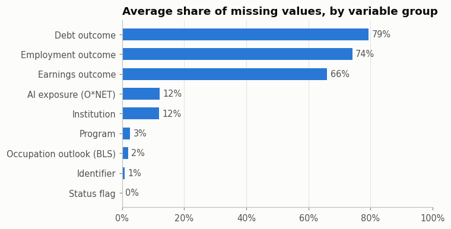{width=76%}

# Exploratory Data Analysis: what we examined and why

We used EDA to test assumptions **before** selecting models, uncover errors and leakage, determine whether transformation was warranted, understand the target distribution and identify useful features. The original EDA notebook was produced by our team and credited in its source to Manoj Elangovan Jayanthi [2]. We preserved it and include its original embedded figure images below; our separate audit rechecked the reported counts.

## Distribution and transformation of earnings

A raw-scale histogram was necessary because salary is not symmetric. Our original EDA and independent numeric audit show **skewness around 1.80** for observed four-year earnings. The log of observed positive earnings is approximately symmetric (our independent calculation of log skewness **0.036**). This matters: a long upper tail can lead squared-error objectives to chase a small number of extreme programs.

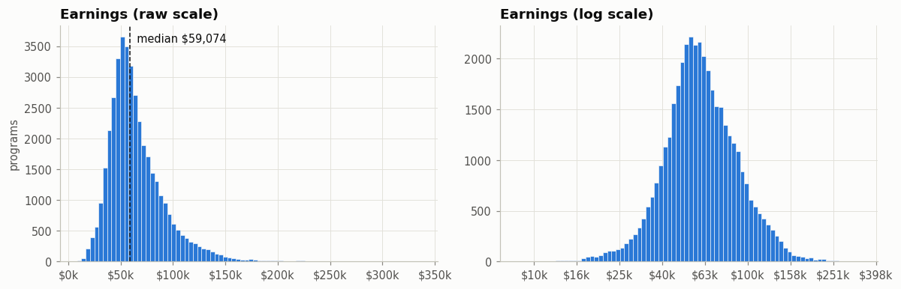{width=94%}

**Our transformation decision.** We explored the logarithm for *diagnosis and visualization*, but deliberately **did not use a log target in the final regression**. All four models predict directly in raw U.S. dollars, and our primary evaluation metric is dollar-scale mean absolute error (MAE). This maintains a clear business interpretation: "average absolute deviation of USD X from the reported program median." We also report root mean squared error (RMSE) to show sensitivity to large misses, with R-squared as a secondary fit summary.

## Why we examined credential levels and restricted the target

The EDA demonstrated material differences between certificate, associate, bachelor's, graduate and professional-degree earnings distributions. A single model pooling all credentials without a credential effect would conflate fundamentally different education pathways and salary distributions. We therefore followed the notebook's bachelor's-focused modeling proposal, isolating **credential_level = 3** and a consistent reported four-year earnings target.

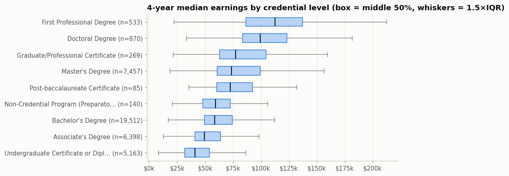{width=92%}

## Why program major and institutional characteristics matter

Major family is a plausible predictor because different curricula map to different occupational labor markets. We compared the median and middle-half spread across sufficiently represented bachelor's fields rather than relying only on an overall average. The original analysis found high medians for Engineering relative to Visual and Performing Arts, but with overlapping distributions and school-to-school variability.

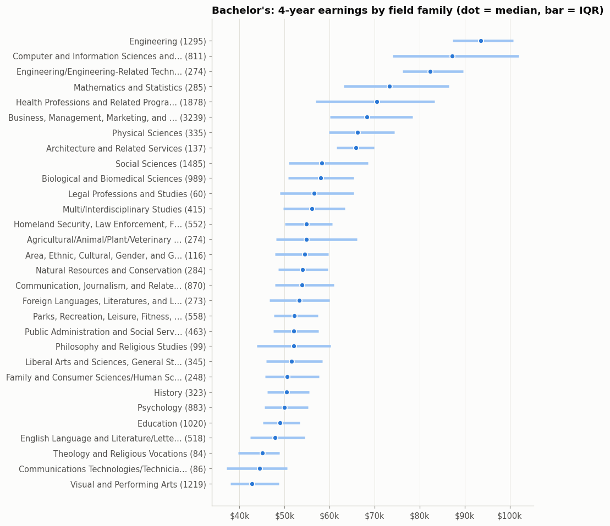{width=82%}

We also examined institution control and region to detect broad context differences and possible imbalance. These distributions justified retaining a compact set of institutional categorical features. We did **not** infer that changing a school's category or geographical region by itself *causes* the observed earnings difference.

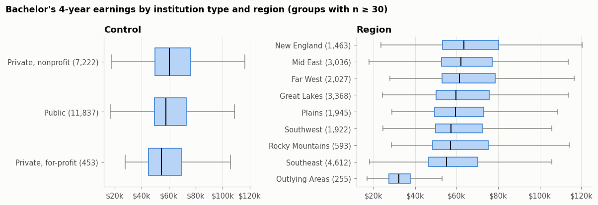{width=92%}

## Associations, collinearity and AI-related exposure

We explored **Spearman rank correlations** between numeric institutional, occupational and AI-exposure proxies and earnings because monotonic relationships need not be linear. The occupational wage, growth and AI-related indicators showed relevant associations. We retained a compact predefined feature set rather than treating every high-correlation field as safe; some variables, such as national four-year earnings benchmarks and earnings growth from later outcomes, are target leakage even when predictive.

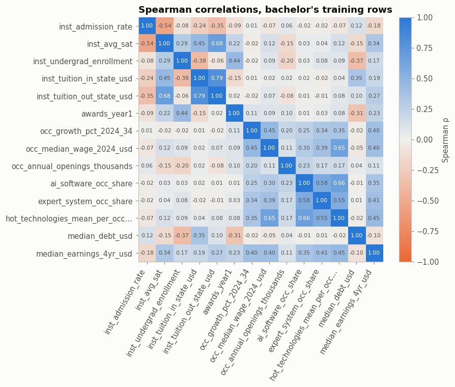{width=76%}

The AI-software share and occupation-growth charts supplied business context, not causal evidence that AI adoption raises graduate pay. Occupational exposures partly reflect which sectors and majors a program maps to.

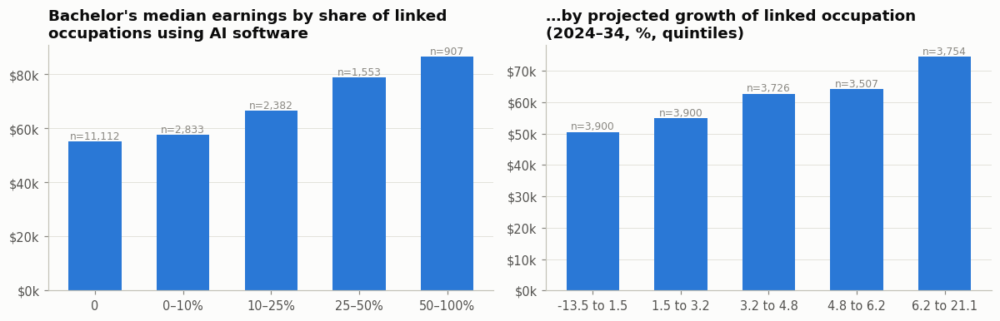{width=93%}

## Debt-risk exploration and why we did not make it the final target

We examined annual loan payment as a fraction of first-year reported earnings to understand student affordability and potential alternative research questions. At the exploratory **8% threshold**, the notebook found approximately **35.7%** of eligible training observations would be labeled high risk. Moving the cutoff changes prevalence sharply. This informed our business discussion about financial interpretation, but a valid classifier would need separate features that exclude loan payments and early earnings that mechanically define its target.

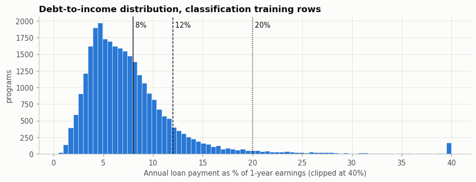{width=83%}

We did not claim any classification accuracy, precision, recall or classifier model because none was run in the final experiment.

# Preprocessing, leakage prevention and validation design

## Fourteen input variables and their transformations

We made the original EDA's proposed **14-feature input design** explicit. The selected nine numeric features were admission rate, average SAT, undergraduate enrollment, in-state tuition, out-of-state tuition, first-year awards count, linked occupation growth, linked occupational median wage and the share of linked occupations using AI software. The sole binary feature was the HBCU designation. The four categorical inputs were institutional control, field-of-study family, geographical region and distance education.

| Feature group | Missing-data handling | Transformation and rationale |
|:---|:---|:---|
| Nine numeric predictors | Median imputation inside each training fold | Add missingness indicators, because absent SAT/tuition/admissions can contain information; **standardize only for Ridge** |
| One binary predictor | Most frequent value, fitted per fold | Binary numeric representation for school descriptor |
| Four categorical predictors | Explicit "Missing" value within fold | One-hot encoding; infrequent groups handled at minimum frequency 20; prevents arbitrary ordinal ranking |
| Response: four-year earnings (USD) | **Never impute missing targets** | Keep original positive raw dollars; no target logarithm in the final model |

We implemented this in scikit-learn `Pipeline` and `ColumnTransformer` objects [4]. Every candidate fits imputers and encoders **only on the fitting portion** of each fold. This matters: fitting encoders or medians globally before validation could allow the validation population to influence the estimator. Histogram boosting and random forests can express nonlinear relationships without numeric standardization; Ridge uses standardized numeric inputs to stabilize its regularized linear coefficients.

## Features deliberately excluded

We excluded `median_earnings_1yr_usd`, `median_earnings_5yr_usd`, `earnings_vs_national_pct`, outcome trajectories, status flags announcing whether targets were reported, debt-to-earnings ratios, post-graduation cohort outcomes and the institutional identifiers. In particular, `earnings_vs_national_pct` directly uses the four-year earnings target, and `national_median_earnings_4yr_usd` was computed across all programs, including held-out outcomes. These would yield artificially optimistic predictions. No institutional identifier such as `opeid6` or `unitid` enters the model.

We retained institution control and HBCU indicators from the original 14-variable design but acknowledge potential fairness and representation concerns in any future deployment.

## Institution-level holdout and cross-validation

If multiple majors from one school appeared in both training and test, their shared tuition, admissions and regional context could inflate measured performance. We therefore used the **original EDA's frozen institution-grouped split**:

| Partition | Bachelor's programs with observed earnings | Distinct institutions | Permitted use |
|:---|---:|---:|:---|
| Development/train | **19,512** | **1,420** | Model selection, preprocessing and hyperparameter tuning |
| Locked final test | **5,771** | **379** | **One evaluation after tuning** |
| Total observed bachelor's | **25,283** | 1,799 | Reported-label research population |

We verified **zero overlapping schools** between train and test. Within development data, the frozen `cv_fold` values 0-4 also assign every school to only one validation fold; there are **no within-school cross-fold leaks**. We kept the original row-level split ID file without re-randomizing. The original EDA's baseline of about USD 15,799 used a fresh `GroupKFold` on its bachelor's subset; our canonical preassigned full-base folds yield **USD 15,806** for the same mean-only method. This minor difference reflects fold assignment, **not** a contradictory outcome.


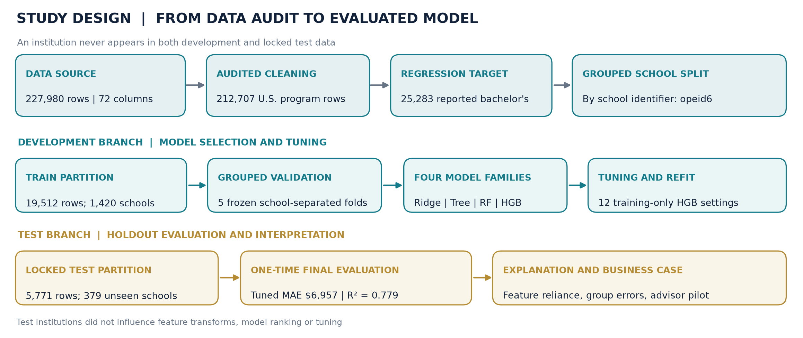{width=95%}

The workflow makes the evaluation boundary explicit: **four algorithms and all 12 boosting settings were selected only within the development branch**. The locked test institutions entered only after the best configuration had been fitted. Post-fit error and permutation analyses explain the result; they were not used to change the chosen model.

# Comparing four different model families

We defined a mean-only `DummyRegressor` as a reference and selected four materially different algorithms. All four used the same 14 raw features, the exact same school-disjoint five folds and the same raw-USD loss for fair comparison.

| Family | Method and motivation | Key limitation |
|:---|:---|:---|
| **Ridge Regression** | Regularized linear model; transparent baseline for approximately additive relationships | Misses complex field-by-institution interactions without explicit terms |
| **Decision Tree** | Recursive splits create understandable nonlinear rules | High variance; a single tree can generalize poorly |
| **Random Forest** | Bagging averages many randomized trees to reduce variance | More resource intensive and less directly explainable |
| **Histogram Gradient Boosting** | Sequential trees correct remaining residual patterns; efficient nonlinear modeling | Requires careful regularization and validation to avoid overfitting |

## Five-fold model selection results

| Predictor | CV MAE (USD) | CV RMSE (USD) | Mean CV R-squared |
|:---|---:|---:|---:|
| **Histogram Gradient Boosting** | **6,880.79** | **9,903.75** | **0.7701** |
| Random Forest | 6,918.22 | 10,074.52 | 0.7624 |
| Decision Tree | 8,247.56 | 11,924.36 | 0.6675 |
| Ridge Regression | 8,964.19 | 12,790.52 | 0.6165 |
| Mean-only benchmark | 15,806.18 | 20,697.67 | -0.0012 |

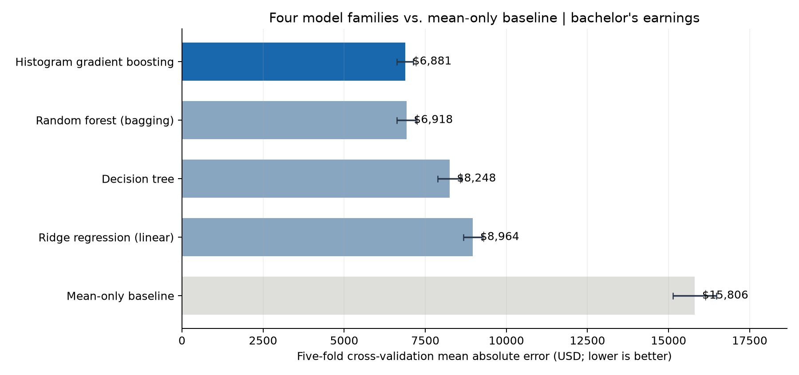{width=94%}

The predeclared selection metric was **the unweighted average of the five fold-level MAEs**, lower being better. Boosting won by a margin of only **USD 37.43** over random forest; we therefore selected it **for further tuning**, not because we had demonstrated overwhelming superiority over the forest. The forest would also be a defensible candidate in a later experiment.

# Fine-tuning the selected model

## Why tune, and how we protected the test

After choosing the winning family, we searched **12 predetermined hyperparameter settings**, including the original configuration, with a seeded candidate list. Every setting was evaluated using the same five institution-disjoint training folds. Thus we ran **60 training/validation fits**, selected the smallest mean CV MAE and refit that configuration on the entire 19,512-program development partition. **No test outcome was used to select parameters.**

Hyperparameters control model flexibility and generalization: learning rate governs how much each successive tree adjusts predictions; iteration count determines the ensemble length; leaf count and minimum leaf size regulate interaction complexity; L2 regularization discourages excessive sensitivity to individual patterns.

| Hyperparameter | Before tuning | After tuning |
|:---|---:|---:|
| Learning rate | 0.070 | **0.095** |
| Number of iterations | 170 | **170** |
| Maximum leaf nodes | 31 | **47** |
| Minimum observations per leaf | 30 | **15** |
| L2 regularization | 1.0 | **4.0** |

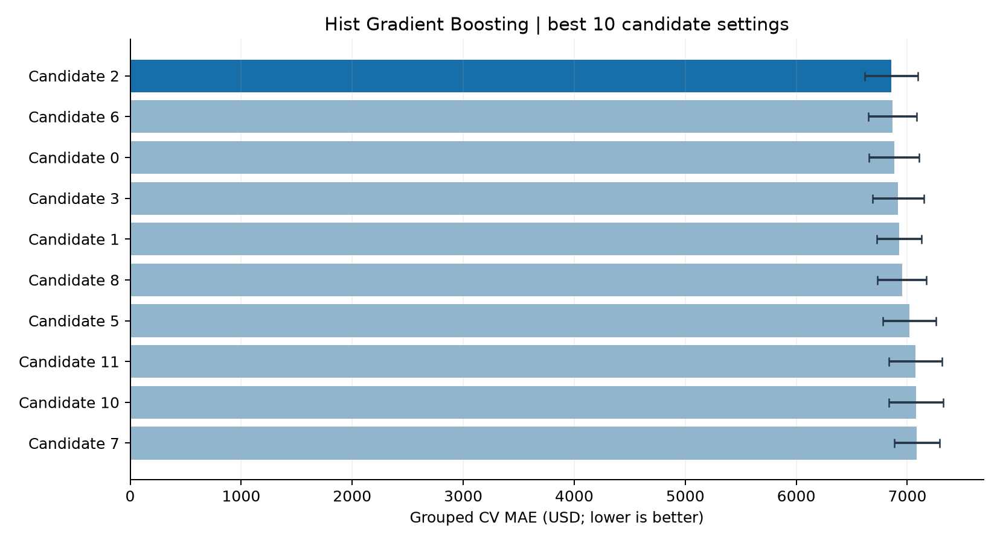{width=92%}

## Before and after tuning: validation

| Measure | Untuned Gradient Boosting | Tuned Gradient Boosting |
|:---|---:|---:|
| Training-only grouped CV MAE | **USD 6,880.79** | **USD 6,855.28** |
| Observed absolute improvement | - | **USD 25.51** |
| Relative CV improvement | - | **0.37%** |

These gains are real measurements but small. The search ranked the configurations; it did not prove the top setting is meaningfully superior across future cohorts.

## Locked holdout evaluation

We then evaluated the frozen tuned estimator on **5,771 programs at 379 previously unseen institutions**. We also refit the original untuned boosting configuration and a mean-only comparator on the training partition so the final numbers reflect the **same test observations**:

| Held-out model | MAE (USD) | RMSE (USD) | R-squared |
|:---|---:|---:|---:|
| **Tuned boosting** | **6,956.68** | **10,111.64** | **0.7793** |
| Untuned boosting | 6,993.01 | 10,173.43 | 0.7766 |
| Mean-only predictor | 16,137.72 | 21,586.67 | -0.0057 |

Relative to the constant mean, tuning plus nonlinear modeling reduced held-out MAE by **56.89%**, corresponding to **USD 9,181.04 less prediction error**, **not** monetary earnings gained by students. Relative to untuned boosting, the tuned model improved MAE only by **USD 36.34, or approximately 0.52%**.

We independently recomputed all three holdout metrics from the saved frozen pipeline and the original public dataset. To check whether the tiny tuning difference was reliable, we performed a **paired 2,000-resample bootstrap resampling the 379 held-out institutions**. The descriptive 95% range for *tuned minus untuned* MAE was **-USD 107.73 to +USD 40.11**. Because this range includes zero, **we do not claim that hyperparameter tuning reliably improved generalization**. The large difference against the mean baseline was robust in the same descriptive resampling check.

\clearpage

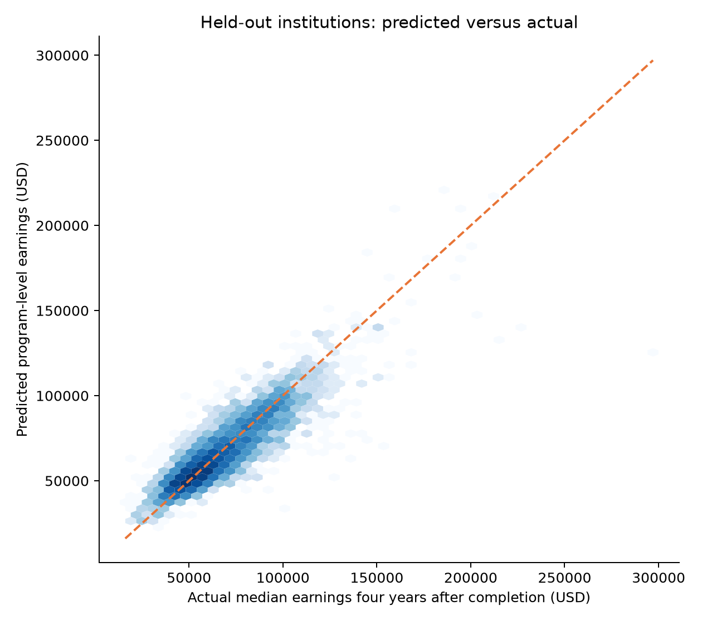{width=77%}

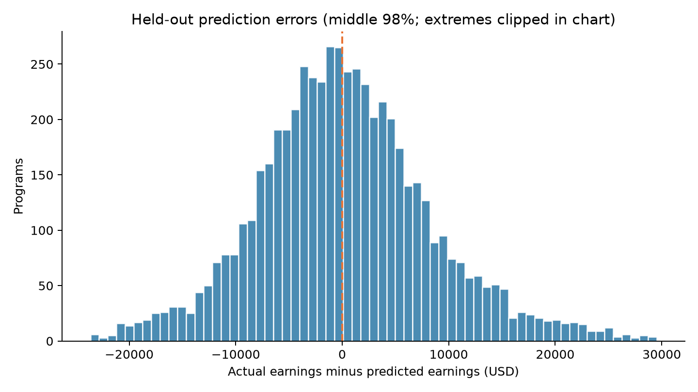{width=83%}

Our tuned model had a **median absolute error of USD 5,069**; its **90th percentile absolute error was USD 14,800**. The higher value warns against overstating precision for a particular program. The test-set R-squared of 0.779 describes variation in *reported program medians*, not a causal explanation of individual graduate earnings.

# Model explanation, error analysis and reliability

## How we explained the final fitted model

A boosted-tree ensemble predicts by adding small corrective tree contributions to an initial estimate. It can represent nonlinear relationships and interactions, but individual tree thresholds are not an adequate policy explanation. We therefore used **permutation importance on the already frozen model**, measuring how much the prediction MAE increases when one *raw input* is shuffled.

We used a reproducible **2,000-program subset of the held-out sample** with three seeded repetitions per feature. This was **post-selection interpretation only**: we did not use these feature rankings to refit or retune the predictor.

| Input | Additional MAE after shuffling input |
|:---|---:|
| Field of study / CIP family | **USD 4,578** |
| Linked occupation growth projection | **USD 3,036** |
| AI-software occupation share | **USD 2,352** |
| Median linked occupation wage | **USD 1,607** |
| Institution region | **USD 987** |
| Out-of-state tuition | **USD 943** |
| Institution average SAT | **USD 920** |

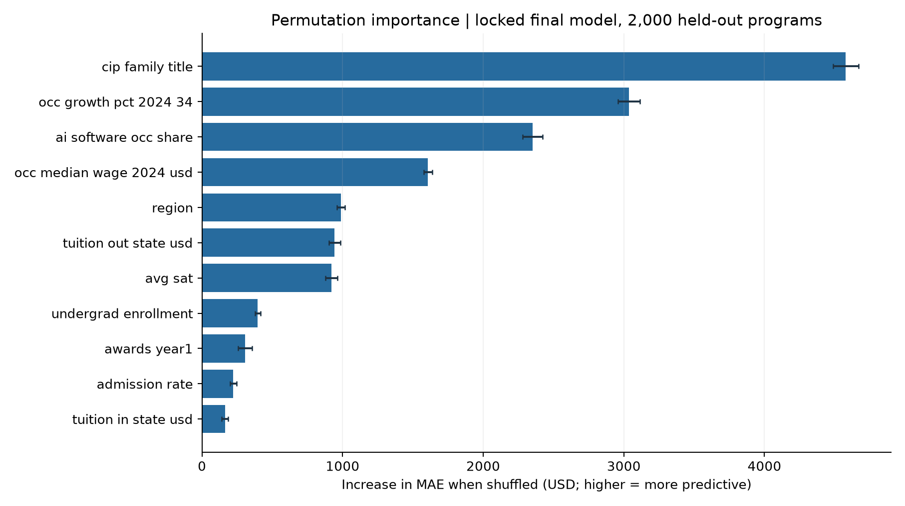{width=94%}

We interpreted these as **associations useful to the model**, not interventions. For example, AI-software exposure overlaps with technology-intensive occupations and major families, so it would be wrong to conclude that adding AI tools to an academic program will produce the observed salary gain. Correlated features can also make individual permutation scores difficult to isolate.

## Does our model perform equally well for different groups?

We examined **36 reporting-qualified** field, region and institution-control slices with at least 50 test programs each. We kept the error units in dollars and included group sample sizes instead of comparing very small groups with unstable averages.

| Held-out bachelor's major family | Test programs | MAE |
|:---|---:|---:|
| Engineering | 361 | USD 5,547 |
| Education | 281 | USD 4,393 |
| Social Sciences | 509 | USD 6,241 |
| Business, Management and Marketing | 890 | USD 7,568 |
| Health Professions | 541 | USD 8,657 |
| Visual and Performing Arts | 366 | USD 6,009 |

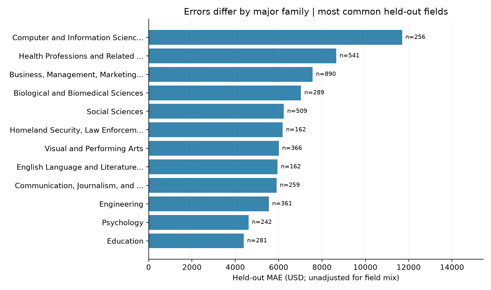{width=93%}

The largest observed-outcome quintile had MAE around **USD 10,595**, versus about **USD 4,814** in the second earnings quintile. We observed directional regression toward the middle of the distribution: for the lowest outcome quintile the model's mean prediction exceeded mean observed earnings by about USD 5,383, while the highest observed quintile's mean prediction fell short by about USD 6,614.

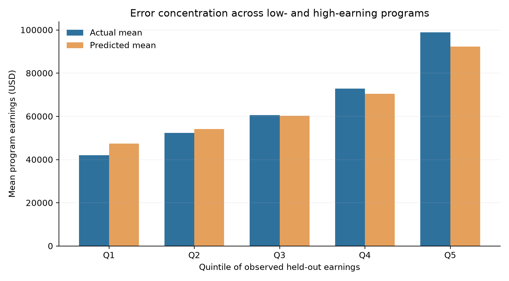{width=87%}

The quintile comparison is **descriptive on the final test sample**, not evidence that we tuned against the test set. It also should not be misread as a confidence band or calibrated probability interval. These observations motivate targeted reliability work before any real deployment.

\FloatBarrier

# Business case: who can use these findings, and how?

## Problem-to-solution mapping

Our business question is whether students and university advisors can use public program-level data **more responsibly** by combining observed outcome disclosures with model-derived directional benchmarks. A model does not create new wages or change the actual financial value of a degree; it can potentially improve the *clarity and consistency* of comparisons.

| Stakeholder | Proposed use | Human safeguard |
|:---|:---|:---|
| Prospective bachelor's student | Compare major families and career context | Show verified official reported earnings first, not only estimates |
| Career or academic advisor | Explain differences within and across fields | Contextualize uncertainty, non-economic preferences and the person |
| University program director | Flag outcomes that warrant qualitative review | Avoid treating predicted-observed gaps as causal program effects |
| Institutional researcher | Track reporting coverage, model drift and subgroup differences | Require independent validation, versioning and fairness review |

We recommend building an **internal, human-supervised prototype** rather than an automated college ranking or high-stakes admissions/financial-aid decision system. The prototype should display the actual publicly reported program median when available, model estimate when justified, a plain-language typical dollar-error warning, source metadata and the fact that many programs lack a reportable earnings outcome.

## Practical recommendations grounded in our results

**Recommendation 1 - Compare major context, not just university reputation.** Field family was the dominant permutation input. We would show majors, occupational linkage and observed outcomes together, rather than collapsing all majors at a college into one number. This is a proposed user-interface improvement, not proof that changing majors causes higher income.

**Recommendation 2 - Disclose uncertainty, especially for very high earners.** Our 90th percentile held-out absolute error was about USD 14,800 and the highest actual-income quintile was less accurate than central groups. An interface should prominently label estimates and discourage precise decisions based on a single predicted figure.

**Recommendation 3 - Use AI and job-growth variables as descriptive signals.** Their predictive contribution is meaningful, but these measures overlap with industry composition. We would not present "AI exposure" as a simple causal lever for program salary growth.

**Recommendation 4 - Never infer absent labels as measured outcomes.** Only 24.36% of all cleaned records reported four-year earnings. We would show data-coverage warnings and abstain if the intended use does not resemble the observed bachelor sample.

## Proposed implementation and evaluation plan

We propose five practical pilot gates, to be agreed with an actual educational partner:

1. **Data-governance gate:** verify source licensing, latest field coding, reporting suppression and data provenance; reproduce the frozen dataset.
2. **Independent model gate:** evaluate on a later cohort or externally collected institutions, not another tuning pass on this test split; compare MAE, RMSE, absolute-error quantiles and drift.
3. **Advisor-only prototype:** surface verified reported outcomes first, with model estimates clearly marked. Conduct usability sessions and test comprehension of the distinction between program and individual salary.
4. **Fairness/reliability check:** monitor errors by institution control, major, region, missing-feature patterns and other legally appropriate audited groups. Agree mitigation and abstention rules before exposing predictions publicly.
5. **Controlled rollout decision:** expand only after stakeholders can demonstrate informed comparison, stable data coverage, error transparency and user understanding.

Suggested KPIs include **independent cohort MAE**, **model/data coverage**, **subgroup error dispersion**, **frequency of missing inputs**, **understanding of uncertainty**, **advisor acceptance** and **reported harmful misunderstandings**. Proposed thresholds are design requirements to be set *before* a pilot, not achieved outcomes of our study.

## What our results do *not* establish

We did **not** measure an economic return, tuition savings, better career placement or higher earnings caused by a recommendation. In particular, the USD 9,181 reduction in absolute **prediction error** against a mean-only model is **not** USD 9,181 of value captured by a student or institution. A real commercial business case would require tracking prospective users' decisions, the cost of data integration and quality assurance, and long-term outcomes under an ethical evaluation design.

# Threats to validity, ethics, and limitations

| Risk | Why it matters | Our response / recommended next validation |
|:---|:---|:---|
| **Privacy-suppressed outcomes** | Label reporting is incomplete and nonrandom | Restrict conclusions to observed bachelor programs; assess coverage shift |
| **Historical/cohort context** | Outcomes relate to earlier graduating cohorts; current inputs and labor projections may be measured in a different period | Evaluate time alignment and a future-cohort holdout |
| **Institution-grouped split only** | Unseen schools in one source snapshot do not prove performance in future labor markets | Require temporal/external validation |
| **Program average vs. individual** | Student experience and salary vary widely within a program | Never use output as individual compensation forecast |
| **Correlation and proxy variables** | Major, region, SAT, HBCU status, AI share and occupation data can reflect confounding and structural inequalities | Report as associations; examine feature necessity and subgroup behavior |
| **Rarity and distribution tails** | Highest-earning programs have larger typical errors | Display quantile caveats; avoid precision claims |
| **Hyperparameter search variance** | Small tuned-minus-untuned MAE difference can be sampling noise | Report institution-bootstrap interval crossing zero |
| **No causal cost-benefit measure** | Earnings alone do not capture tuition, debt risk, living costs or fulfillment | Treat cost/ROI analyses as future distinct studies |

We must not use this classroom model for automated admissions, financial aid, school closure decisions, or individual high-stakes advice. Sensitive-group or proxy variables such as the institutional HBCU flag require explicit fairness and purpose review before real deployment. Our present conclusion is technical feasibility **within this reported-source sample**, not operational readiness.

# Reproducibility, file organization, and sources

## Project artifacts and where the team can find them

| Project phase | Canonical file or folder | What we preserved |
|:---|:---|:---|
| Source EDA | `College_Majors_EDA_Colab.ipynb` | Original file byte-for-byte; source author credited |
| Existing EDA summary | `reports/EDA_SUMMARY.md` | Source notebook and report-derived data exploration |
| Dataset and split | `DATA.md`, `data/split_ids.csv`, GitHub Release `data-v1.0.0` | Reviewed, checksum-verified CSV files |
| Cleaning/integrity audit | `modeling/eda_audit.py`; `reports/eda_cleaning_audit.csv`; `reports/eda_audit.json` | Independent check of original methods and counts |
| Four model comparison | `modeling/model_selection.py`; `reports/model_comparison.csv`; `reports/model_selection_folds.csv` | Train-only model scores and figure |
| Hyperparameter search | `modeling/model_fine_tuning.py`; `reports/tuning_candidates.csv`; `reports/model_evaluation.json` | Selected parameters and locked holdout scores |
| Explainability | `modeling/model_explainability.py`; `reports/feature_importance.csv`; `reports/error_by_segment.csv` | Post-selection diagnostic metrics and figures |
| Technical and business write-ups | `reports/MODEL_EXPLANATION.md`, `reports/BUSINESS_CASE.md` | Expanded evidence and proposed business pilot |
| **Final report** | **`submission/Group_2_Final_Project_Report.md` and `.pdf`** | Editable source and direct-submission PDF |

Additional generated row-level holdout predictions are published as `reports/heldout_predictions.csv`, containing aggregate public program identifiers, reported outcome and two prediction variants. We did not commit local trained-object `.joblib` files, caches, credentials, unverified raw data or virtual environments. The **126.3 MB original CSV** is stored as a versioned GitHub **Release asset**, because ordinary GitHub Git rejects blobs larger than 100 MiB; the canonical split CSV is tracked directly. The raw CSV and both release assets remain publicly retrievable.

## Commands to reproduce

We start with Python 3.10-3.13 and use the project's cross-platform `setup.py`. The single command installs the required scientific Python dependencies into `.venv` and verifies the exact downloaded public CSV. The following commands run inside the created environment:

```bash
# Windows and Linux: install and verify source dataset
python setup.py

# In the activated project .venv (or with .venv's Python):
python -m modeling.eda_audit
python -m modeling.extract_eda_figures
python -m modeling.model_selection
python -m modeling.model_fine_tuning
python -m modeling.model_explainability
python -m unittest discover -s tests -v
```

On systems without `python`, Linux users can invoke `python3 setup.py`. The [README](../README.md) describes how to run the project with the correct interpreter without global Python installation. The Markdown-to-PDF conversion requires Pandoc and an installed LaTeX PDF engine; **the finished PDF is already included in the submission folder**, so grading does not require rebuilding it.

Our fixed original notebook SHA-256 is:

```text
418649971708968b7d999cfc9dc08fc09a9890f331c0ab32ac48829dfbdafe42
```

We use random seed **42**, record our exact holdout IDs and CV folds in `data/split_ids.csv`, fit preprocessing inside each fold, and store model parameters, metrics, test predictions and feature scores as machine-readable outputs. Importantly, reproducing the experiment is **not** the same as generating a new independent test set: the latter requires new data.

## Attribution and reference sources

[1] *College Majors 2026: Earnings, Debt, Jobs, AI*, Kaggle dataset publisher **kylefengkfeng209**. Dataset version and license details: [source listing](https://www.kaggle.com/datasets/kylefengkfeng209/college-majors-2026-earnings-debt-jobs-ai), [dataset manifest](../DATA.md) and [Creative Commons Attribution-ShareAlike 4.0](https://creativecommons.org/licenses/by-sa/4.0/). The source lists College Scorecard, NCES CIP-to-SOC mapping, BLS projections and O*NET as its underlying sources.

[2] **Original team EDA notebook:** `College_Majors_EDA_Colab.ipynb`, BUAN 6341 Group 2; author credited in the notebook as **Manoj Elangovan Jayanthi**. All EDA graphics labeled "Original EDA" are unmodified decoded image outputs from that file. See `reports/eda_figure_manifest.json` for per-figure source cell indices and SHA-256 hashes.

[3] **Original EDA summary and independent audit:** `reports/EDA_SUMMARY.md`, `modeling/eda_audit.py`, and `reports/eda_audit.json`. Our independently checked row-count, share-across-campuses and target-availability results match the original notebook.

[4] **Modeling scripts and evidence:** `modeling/common.py`, `modeling/model_selection.py`, `modeling/model_fine_tuning.py`, `modeling/model_explainability.py` and their companion `reports/*.csv`, `reports/*.json` results. The pipeline uses scikit-learn estimators, group-disjoint validation, a bounded training-only search, raw-feature permutation importance and institution-clustered bootstrap diagnostics.

[5] **Technical interpretation and business context:** `reports/MODEL_EXPLANATION.md`, `reports/BUSINESS_CASE.md`, both part of our reproducible group repository.

# Conclusion

We completed the full workflow from **dataset audit and EDA through four model families, careful selection, hyperparameter tuning, holdout evaluation, interpretability and a responsible business case**. Our strongest model is histogram gradient boosting on the reported bachelor's-program target, with **USD 6,957 held-out MAE**, substantially below the mean-only baseline. It is equally important to report that the **USD 36 tuning improvement over untuned boosting is not reliably distinguishable from zero** on this school-separated test. The original notebook remains unchanged, and every headline number and illustration is supported by a recorded source or executed experiment.

We conclude that public institution and occupation information supports a useful **research-level program earnings benchmark** for appropriately covered bachelor's programs. The next responsible step is an independently validated, advisor-supervised prototype that explains its errors and missingness; it is **not** a promise of individual salary, causal educational benefit or verified financial return.

\clearpage

## Team handoff: next validation priorities

The following are **recommendations for future work, not completed experiments or proof of business impact**. Our team proposes prioritizing them before any release of individual program predictions.

| Proposed next activity | Evidence that makes it necessary | What would count as acceptable progress |
|:---|:---|:---|
| **External time-based validation** | Our current test separates schools within one published snapshot, not future labor-market cohorts. | Repeat evaluation on newly released, time-aligned program outcomes without retuning on the original holdout. |
| **Coverage and subgroup audit** | Fewer than one-quarter of cleaned programs report the four-year target; predictive error varies by major and earnings level. | Publish coverage by program group, sample sizes, MAE and high-error rates; define an abstention policy before any external pilot. |
| **Advisor-led interpretation pilot** | The model reduces prediction error but has not been shown to improve student choices or financial outcomes. | Test whether advisors and students understand the difference between observed program earnings, estimated medians and individual salaries. |
| **Separate debt-risk study, if approved** | The exploratory 8% debt-risk label is not a validated classifier and combines earnings and loan-payment information. | Agree on a population, target definition and leakage-safe feature set, then run an independent grouped classification experiment. |

Our submission therefore establishes a **reproducible research benchmark and documented evaluation boundary**, not a production system or validated causal policy intervention. The primary handoff decision is to retain the tuned boosting model as a research candidate, keep its uncertainty visible, and seek new evidence before using predictions for consequential advice.
